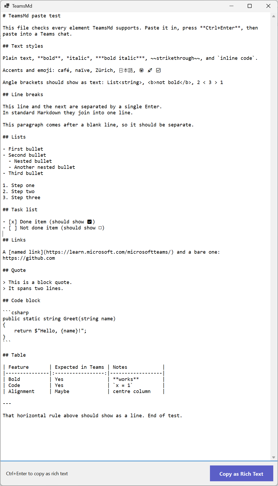
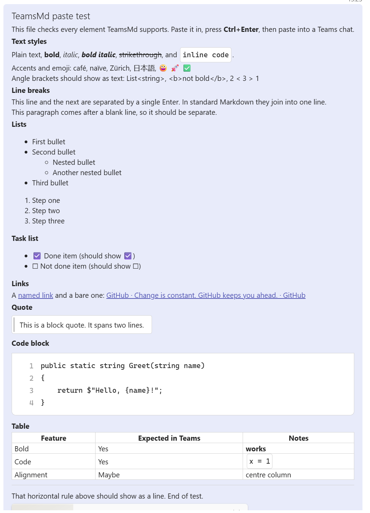

# TeamsMd

A small Windows app for getting formatted text into Microsoft Teams. Type or paste Markdown, click **Copy as Rich Text** (or press **Ctrl+Enter**), then paste into a Teams chat, channel post or meeting chat. Headings, bold, lists, code blocks and so on arrive formatted, not as raw `**` and `#`.

<table>
  <tr>
    <th>Markdown in TeamsMd</th>
    <th>After pasting into Teams</th>
  </tr>
  <tr>
    <td valign="top"></td>
    <td valign="top"></td>
  </tr>
</table>

## Using it

1. Run `TeamsMd.exe`. It's a single file, so there's nothing to install and you don't need .NET.
2. Type or paste Markdown into the text box.
3. Click **Copy as Rich Text** or press **Ctrl+Enter**. The status line confirms the copy.
4. Paste into Teams with **Ctrl+V**.

The first time you launch it, the box holds a sample covering every supported element, already selected. Paste into Teams to see what survives, or just start typing to replace it.

### Keyboard shortcuts

| Keys | Action |
|------|--------|
| Ctrl+Enter | Copy as rich text |
| Ctrl+A | Select all text in the box |

### Your text is kept

The text box contents are saved automatically a second after you stop typing, and again when you close the window. Next time you open the app, your text is still there. The draft is stored at:

```
%LOCALAPPDATA%\TeamsMd\draft.md
```

Delete that file to reset the app. It will show the sample again on the next launch.

## What gets copied

TeamsMd puts two formats on the clipboard at once:

- **Formatted HTML**, used by Teams, Outlook, Word and other apps that accept rich text.
- **Your original Markdown as plain text**, used by Notepad, terminals and other plain-text apps.

The app you paste into picks the format it understands.

### Supported Markdown

| Element | Markdown | Notes |
|---------|----------|-------|
| Headings | `# Title`, `## Section` | |
| Bold / italic | `**bold**`, `*italic*` | |
| Strikethrough | `~~text~~` | |
| Bulleted and numbered lists | `- item`, `1. item` | Nesting works |
| Task lists | `- [x] done`, `- [ ] todo` | Shown as ☑ / ☐, because Teams strips checkboxes |
| Links | `[text](https://…)` or a bare URL | |
| Inline code | `` `code` `` | |
| Code blocks | ` ``` ` fences | No syntax colouring; the language name is ignored |
| Block quotes | `> quote` | |
| Tables | `\| a \| b \|` pipe tables | Teams may restyle them or drop column alignment |
| Horizontal rule | `---` | |

### Things to know

- **Single line breaks are joined.** Following standard Markdown, two lines separated by a single Enter become one line. Leave a blank line between them to start a new paragraph.
- **HTML in your text is shown as text.** Writing `<b>` or `List<string>` displays exactly that and doesn't change the formatting.
- **Teams has the final say.** Teams cleans up anything it pastes. For example, it centres table headers, adds line numbers to code blocks, and may replace a bare URL with the page's title.

## Building from source

You need the [.NET 10 SDK](https://dotnet.microsoft.com/download). You can build on Windows or Linux; Linux can cross-compile the Windows exe.

```bash
# Run the tests
dotnet test

# Build the standalone exe (about 50 MB, no .NET install needed to run it)
dotnet publish src/TeamsMd.App -c Release -r win-x64 --self-contained \
  -p:PublishSingleFile=true -p:EnableCompressionInSingleFile=true -o publish
```

The app is written to `publish/TeamsMd.exe`.

### Project layout

```
src/
  TeamsMd.Core/         Conversion and storage logic (no UI, runs anywhere)
    MarkdownConverter   Markdown → plain HTML, via Markdig
    CfHtml              Wraps HTML in the Windows clipboard "HTML Format"
    ClipboardPayload    Builds what goes on the clipboard
    DraftStore          Saves and loads the text box contents
    SampleMarkdown      The first-launch sample (embedded from samples/)
  TeamsMd.App/          Windows Forms window and clipboard access
tests/
  TeamsMd.Core.Tests/   xUnit tests for everything in Core
samples/
  teams-test.md         Sample covering every supported element
docs/superpowers/       Design and implementation plan
```

### Testing a change in Teams

The automated tests cover conversion and clipboard packaging, but only Teams decides what a paste looks like. After changing the conversion, run the exe, copy `samples/teams-test.md` as rich text and paste it into a Teams chat to check the result.
